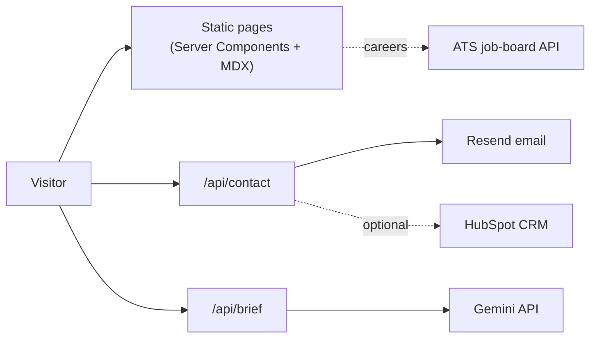

<div align="center">

# Domiutra

The marketing website for Domiutra, a U.S.-managed technology services company. It is statically rendered, accessible and tested, and it includes an AI-assisted project-brief tool.

<a href="https://github.com/abhiishek340/Domiutra/actions/workflows/ci.yml"></a>


> **Build. Modernize. Operate.** Engineering, cloud, AI, and managed services from U.S.-managed global teams.

</div>

## Overview

The site presents Domiutra's services, industries, engagement models and delivery approach, and it turns visitor interest into qualified inquiries. Pages are statically prerendered as React Server Components. Client components are used only where interaction needs them: navigation, forms, the delivery planner and the interactive diagrams. Every integration is controlled by an optional environment variable, so the site runs with no configuration and hides anything that is not set up.

## Features

- **Content-driven pages**: six service pages, six industry pages, case studies, engagement models, the delivery model, careers, about, security and legal pages. All are generated from typed data in `lib/data/` and MDX in `content/`.
- **Insights blog in MDX**: add a file to `content/insights/`, and its page, listing entry, sitemap entry and JSON-LD are generated for you.
- **AI brief assistant**: visitors describe a project and get a structured first-draft brief from Gemini (services, engagement model, team shape, phases, risks and open questions). The brief is validated with Zod and can be handed off to the contact form.
- **Interactive delivery planner**: an estimator that suggests a team shape from the engineering type, involvement level and delivery model.
- **Hardened contact form**: Zod validation on client and server, a same-origin check, rate limiting, a honeypot field and a minimum fill time. Messages are delivered through Resend, with optional HubSpot forwarding.
- **Careers feed**: live job listings from the Greenhouse, Lever or Ashby public job-board APIs.
- **SEO built in**: per-page metadata, JSON-LD, a generated sitemap, robots rules, a dynamic OG image, a web manifest and icons. Non-production Vercel deployments are excluded from search indexing.
- **Accessibility and motion**: the site targets WCAG 2.2 AA, content works without JavaScript, and animations (Motion) respect `prefers-reduced-motion`.
- **Optional analytics**: Plausible or GA4, loaded only when configured.

## Tech stack

| Layer | Technology |
| --- | --- |
| Framework | Next.js 16 (App Router), React 19, TypeScript |
| Styling and motion | Tailwind CSS v4, Motion, Lucide icons |
| Content | MDX (`@next/mdx`, `remark-gfm`), typed data modules |
| Forms and validation | React Hook Form, Zod |
| Integrations | Google Gemini (`@google/genai`), Resend, HubSpot, Greenhouse / Lever / Ashby |
| Testing | Vitest + Testing Library, Playwright, axe-core |
| CI | GitHub Actions (`.github/workflows/ci.yml`) |

## Architecture



## Project structure

```text
app/              Routes, metadata, sitemap, robots, OG image, contact and brief APIs
components/       UI, layout, navigation, sections, cards, diagrams, forms, animations, brief
content/          MDX articles (insights/) and legal pages (legal/)
lib/
  data/           Services, industries, case studies, navigation (typed content)
  brief/          Gemini prompt, response schema, generation and formatting
  contact/        Email delivery, CRM adapters, rate limiting
  estimator/      Delivery-planner logic
  seo/            Metadata and JSON-LD helpers
  careers/        ATS job-board fetchers
  site.ts         Business config read from environment variables
tests/            unit/ (Vitest) and e2e/ (Playwright)
docs/             Design and positioning notes
```

## Getting started

Requires **Node 20.9+**.

```bash
npm install
npm run dev
```

Open [http://localhost:3000](http://localhost:3000).

Every environment variable is optional, so the site runs without any configuration. To turn on email, analytics and the other integrations:

```bash
cp .env.example .env.local
```

### Scripts

| Command | Description |
| --- | --- |
| `npm run dev` | Start the development server |
| `npm run build` | Create a production build |
| `npm start` | Serve the production build |
| `npm run lint` | Run ESLint |
| `npm run typecheck` | Generate route types and run the TypeScript compiler |
| `npm test` | Run unit and component tests (Vitest) |
| `npm run test:watch` | Run Vitest in watch mode |
| `npm run test:coverage` | Run unit tests with coverage thresholds |
| `npm run test:e2e` | Run end-to-end and accessibility tests (Playwright) |
| `npm run check` | Lint, typecheck, test with coverage, and build |

Before the first E2E run, install the browser with `npx playwright install chromium`.

E2E tests build into a separate `.next-test` folder, so they never interfere with a running `npm run dev` or `npm start`. To do the same for a manual build, set `NEXT_DIST_DIR=.next-test`.

### Environment variables

See [`.env.example`](.env.example) for the full list with descriptions.

| Variable | Description |
| --- | --- |
| `NEXT_PUBLIC_SITE_URL` | Canonical site URL (used for SEO and the sitemap) |
| `RESEND_API_KEY`, `CONTACT_EMAIL`, `CONTACT_FROM_EMAIL` | Contact form email delivery |
| `HUBSPOT_ACCESS_TOKEN` | Optional CRM forwarding |
| `GEMINI_API_KEY`, `GEMINI_MODEL`, `GEMINI_FALLBACK_MODEL` | AI brief assistant (Gemini, server-side only) |
| `BRIEF_DEMO_MODE` | Local preview of the assistant without a key (`true`) |
| `NEXT_PUBLIC_CONTACT_EMAIL` | Public email shown on the site |
| `NEXT_PUBLIC_SCHEDULING_URL` | Booking link ("Schedule a conversation") |
| `NEXT_PUBLIC_LINKEDIN_URL`, `NEXT_PUBLIC_GITHUB_URL`, `NEXT_PUBLIC_X_URL` | Social links |
| `NEXT_PUBLIC_ANALYTICS_PROVIDER`, `NEXT_PUBLIC_ANALYTICS_ID` | Analytics (`plausible` or `ga4`) |
| `ATS_PROVIDER`, `ATS_BOARD_ID` | Job listings (`greenhouse`, `lever`, or `ashby`) |

Anything left unset is either hidden or clearly reported as not configured. For example, the contact form never shows a success message unless email delivery is actually set up.

## How it works

### Contact form

1. Create a [Resend](https://resend.com) account and verify your sending domain.
2. Set `RESEND_API_KEY`, `CONTACT_EMAIL`, and `CONTACT_FROM_EMAIL`.
3. Redeploy.

Submissions are validated with Zod on both the client and the server. They are protected by a same-origin check, rate limiting, a honeypot field and a minimum fill time.

### AI brief assistant

Visitors describe their situation and get a first-draft project brief: recommended services, an engagement model, a team shape, phases, risks and open questions. The assistant appears on the homepage, at `/brief`, and as a link on the contact page. It can pass the brief straight into the contact form.

1. Create a key in [Google AI Studio](https://aistudio.google.com).
2. Set `GEMINI_API_KEY`, then redeploy. The default model is `gemini-3.5-flash-lite`. If it is overloaded, the assistant falls back to `gemini-3.8-flash` automatically. Override either one with `GEMINI_MODEL` and `GEMINI_FALLBACK_MODEL`.

Safeguards:

- The key never leaves the server.
- Gemini must return a strict JSON shape, which is validated with Zod.
- It can recommend only the six services the site actually offers.
- Team sizes come from the site's own planner logic, not from the model.
- Visitor text is treated as data and is never stored.
- Requests are rate limited.

Without a key, the feature is hidden. For a local preview, set `BRIEF_DEMO_MODE=true`.

## Editing content

**Add an article:** create `content/insights/<slug>.mdx`:

```mdx
export const meta = {
  title: "Article title",
  excerpt: "One or two sentences.",
  category: "Engineering", // AI | Engineering | Cloud | Outsourcing | Modernization | Leadership
  publishedAt: "2026-11-01",
  readingTime: "6 min read",
}

Your article in Markdown…
```

The page, listing, sitemap entry, and structured data are generated automatically.

**Other content**

| To add or change… | Edit |
| --- | --- |
| A service | `lib/data/services.ts` (and `servicesMenu` in `lib/data/navigation.ts`) |
| An industry | `lib/data/industries.ts` |
| A case study | `lib/data/case-studies.ts` (use `kind: "client"` only for real, approved work) |
| Leadership bios | `lib/data/leadership.ts` |
| Certifications | `lib/data/trust.ts` (only once obtained) |
| Legal pages | `content/legal/*.mdx` |

## Deployment

The project deploys to [Vercel](https://vercel.com) with no extra configuration:

1. Import the repository in Vercel.
2. Add environment variables.
3. Deploy, then set `NEXT_PUBLIC_SITE_URL` to your production domain.

Preview deployments are automatically excluded from search indexing.

## Testing

| Layer | Tool | What it covers |
| --- | --- | --- |
| Unit and component | Vitest + Testing Library | Business logic, contact API, content loading, SEO, navigation, UI components |
| Page rendering | Vitest | Every page renders in React's development build with zero console errors |
| End-to-end | Playwright | Real browser journeys on desktop and mobile, forms, routing, SEO files |
| Accessibility | axe-core | WCAG 2.2 A/AA checks on key pages |

**Coverage** is enforced: the run fails if total coverage drops below 90% (statements and lines), or below 90% for `lib/` and the contact API. Open `coverage/index.html` after `npm run test:coverage` for the full report.

**CI** runs on every push and pull request (`.github/workflows/ci.yml`): lint, typecheck, unit tests with coverage, build, then E2E and accessibility tests.

Tests live in `tests/unit/` (`*.test.ts[x]`) and `tests/e2e/` (`*.spec.ts`).

## Notes

- **Accessibility:** targets WCAG 2.2 AA. Content stays visible without JavaScript, and animations respect `prefers-reduced-motion`.
- **Local network testing:** to open the dev server from another device (e.g. `http://10.0.0.x:3000`), the address must be allowed by `allowedDevOrigins` in `next.config.ts`. Common private ranges are already included.
- **Legal pages** are starter templates and need review by counsel before launch.
- **Case studies** in `lib/data/case-studies.ts` are currently marked `kind: "representative"`. They describe typical engagement shapes, not named client work.
- Design rationale lives in [`docs/design-notes.md`](docs/design-notes.md).

---

Built by [Abhishek Yadav](https://github.com/abhiishek340)
